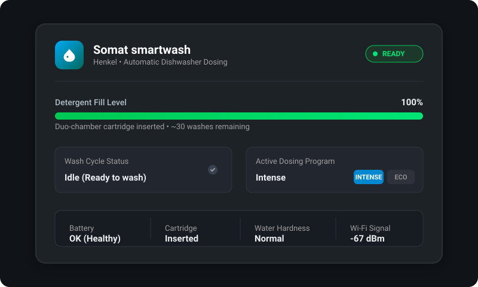
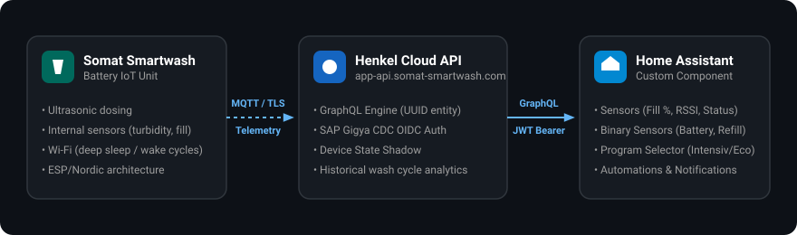

# Somat Smartwash Integration for Home Assistant

[](https://github.com/fboulegue/ha-somat-smartwash/actions/workflows/validate.yml)
[](https://github.com/hacs/integration)
[](https://github.com/fboulegue/ha-somat-smartwash/releases)
[](https://opensource.org/licenses/MIT)
[](https://github.com/fboulegue/ha-somat-smartwash)

Custom integration for Home Assistant to monitor and control the **Henkel Somat Smartwash** automatic dishwasher dosing device.

<p align="center">
  
</p>

---

## ✨ Features

- 💧 **Live Detergent Fill Level**: Real-time percentage indicator and estimated washes remaining.
- 🔄 **Dishwasher State Detection**: Automatically detects when a wash cycle is active, idle, or drying.
- 🎛️ **Program Selection**: Switch dosing programs (`Intense`, `Eco`, `Auto`, `Standard`) directly from Home Assistant.
- 🪫 **Battery & Refill Monitoring**: Early warnings when the battery is low or the detergent duo-cartridge needs replacement.
- 📶 **Diagnostic Telemetry**: Wi-Fi RSSI signal strength, water hardness settings, and cloud connectivity tracking.
- 📊 **Historical Statistics**: Total wash cycle counter and consumed cartridges counter.
- ⚙️ **Modern Config Flow**: 100% UI-based setup with automatic SAP Gigya CDC OIDC authentication and token renewal.
- 🌐 **Multilingual**: English and German (Deutsch) out of the box.

---

## 🏗️ Architecture

The Somat Smartwash device sits inside your dishwasher. Because it operates on an internal battery, it periodically wakes its Wi-Fi interface (`somat-XXXXXX`) to synchronize telemetry with Henkel's cloud servers before returning to deep sleep.

Home Assistant communicates asynchronously with Henkel's cloud API, allowing instant state retrieval without depleting the unit's battery:

<p align="center">
  
</p>

---

## 📦 Provided Entities

### 📊 Sensors

| Entity | ID | Class / Unit | Description |
|---|---|---|---|
| **Detergent Fill Level** | `sensor.somat_smartwash_detergent_fill_level` | `%` (Measurement) | Remaining detergent in percentage |
| **Wash Cycle Status** | `sensor.somat_smartwash_wash_cycle_status` | Text | `idle`, `washing`, `drying`, etc. |
| **Active Program** | `sensor.somat_smartwash_program` | Text | Currently active dosing program |
| **Refill Status** | `sensor.somat_smartwash_refill_status` | Text | Status of the cartridge (`inserted`, `empty`, etc.) |
| **Water Hardness** | `sensor.somat_smartwash_water_hardness` | Diagnostic | Water hardness setting (`soft`, `normal`, `hard`) |
| **Wi-Fi Signal** | `sensor.somat_smartwash_wifi_rssi` | `dBm` (Signal Strength) | Wireless signal strength reported by the unit |
| **Total Wash Cycles** | `sensor.somat_smartwash_wash_cycle_count` | Counter | Total wash cycles executed by this device |
| **Refills Used** | `sensor.somat_smartwash_refill_count` | Diagnostic | Total cartridges replaced over time |

### 🚨 Binary Sensors

| Entity | ID | Device Class | State / Trigger |
|---|---|---|---|
| **Battery Low** | `binary_sensor.somat_smartwash_battery_low` | `battery` | `on` if battery level is not `ok` |
| **Refill Needed** | `binary_sensor.somat_smartwash_refill_needed` | `problem` | `on` if cartridge is empty, missing, or fill ≤ 10% |
| **Washing Active** | `binary_sensor.somat_smartwash_washing` | `running` | `on` while a wash cycle is running |
| **Cloud Connected** | `binary_sensor.somat_smartwash_connected` | `connectivity` | `on` when device has an active cloud link |

### 🎛️ Select

| Entity | ID | Options | Description |
|---|---|---|---|
| **Dosing Program** | `select.somat_smartwash_dosing_program` | `intense`, `eco`, `auto`, `standard` | Changes the program for the next wash cycle |

---

## 🚀 Installation

### Option 1: HACS (Recommended)

1. Ensure [HACS (Home Assistant Community Store)](https://hacs.xyz/) is installed.
2. In Home Assistant, navigate to **HACS** → **Integrations**.
3. Click the three dots (top right) → **Custom repositories**.
4. Enter repository URL: `https://github.com/fboulegue/ha-somat-smartwash`
5. Select category: **Integration**.
6. Click **Add**, find **Somat Smartwash**, and click **Download**.
7. Restart Home Assistant.

### Option 2: Manual Installation

1. Download the [latest release zip](https://github.com/fabianboulegue/ha-somat-smartwash/releases).
2. Extract the archive and copy the folder `custom_components/somat_smartwash` into your Home Assistant `<config_dir>/custom_components/` directory.
   ```
   homeassistant/
   └── custom_components/
       └── somat_smartwash/
           ├── __init__.py
           ├── api.py
           ├── binary_sensor.py
           ├── config_flow.py
           ├── const.py
           ├── coordinator.py
           ├── entity.py
           ├── manifest.json
           ├── select.py
           ├── sensor.py
           ├── strings.json
           └── translations/
   ```
3. Restart Home Assistant.

---

## ⚙️ Configuration

1. In Home Assistant, go to **Settings** → **Devices & Services** → **Add Integration**.
2. Search for **Somat Smartwash**.
3. Enter your login credentials:
   - **Email**: The email address of your Somat smartwash account.
   - **Password**: Your Somat smartwash account password.
4. Click **Submit**. Your device and all entities will be discovered automatically.

---

## 💡 Automation Examples

### 1. Alert When Detergent is Low (Refill Reminder)

```yaml
alias: "Dishwasher: Low Detergent Warning"
description: "Send notification when Somat Smartwash cartridge has 10% or less detergent"
trigger:
  - platform: numeric_state
    entity_id: sensor.somat_smartwash_detergent_fill_level
    below: 15
condition: []
action:
  - action: notify.notify
    data:
      title: "Somat Smartwash"
      message: >
        Detergent is low ({{ states('sensor.somat_smartwash_detergent_fill_level') }}%).
        Please insert a new duo-cartridge into the dosing unit!
mode: single
```

### 2. Notification When Dishwasher Cycle Finishes

```yaml
alias: "Dishwasher: Wash Finished Notification"
description: "Notify household when the dishwasher finishes running"
trigger:
  - platform: state
    entity_id: binary_sensor.somat_smartwash_washing
    from: "on"
    to: "off"
    for:
      minutes: 2
action:
  - action: notify.notify
    data:
      title: "Dishwasher Ready"
      message: "The dishwasher cycle has completed. Clean dishes are ready to be unloaded."
mode: single
```

### 3. Automatically Switch to Eco Mode on Weekdays

```yaml
alias: "Dishwasher: Set Eco Program"
trigger:
  - platform: time
    at: "08:00:00"
condition:
  - condition: time
    weekday:
      - mon
      - tue
      - wed
      - thu
      - fri
action:
  - action: select.select_option
    target:
      entity_id: select.somat_smartwash_dosing_program
    data:
      option: "eco"
```

---

## 🔬 Technical Background

The Henkel Somat Smartwash platform uses:
- **Identity Provider:** SAP Customer Data Cloud (Gigya CDC) on datacenter `eu1.gigya.com` using OAuth 2.0 / OIDC.
- **Backend API:** GraphQL endpoint at `https://app-api.somat-smartwash.com/v1/query` requiring `product: somat` and JWT Bearer authorization.
- **Hardware Telemetry:** Wi-Fi module communicating via MQTT (`web-mqtt.somat-smartwash.com`) during wake periods.

---

## 🤝 Contributing

Contributions, bug reports, and feature requests are welcome!
Feel free to open an issue or submit a pull request on [GitHub](https://github.com/fboulegue/ha-somat-smartwash).

---

## ⚖️ License & Disclaimer

This project is licensed under the [MIT License](LICENSE).

*Disclaimer: This integration is an independent open-source project and is not affiliated with, endorsed by, or associated with Henkel AG & Co. KGaA or Somat. All product names, trademarks, and registered trademarks are property of their respective owners.*
